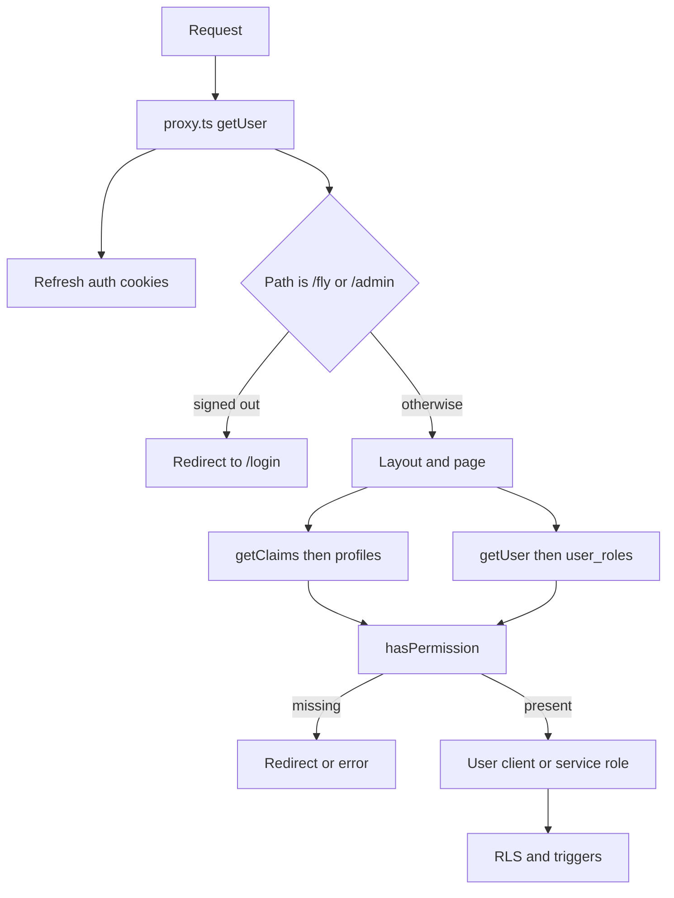

# Architecture

Safety Hub is one Next.js app for one flying club. Authentication answers "who is this?". Authorisation answers "what can they do?". Postgres row level security is the backstop when a request uses the user's Supabase client. The service-role client skips that backstop, so those calls check a permission first.

## Pieces

| Piece | Where | Job |
| --- | --- | --- |
| Proxy | `proxy.ts`, `lib/supabase/proxy.ts` | Refresh the session. Redirect signed-out users from `/fly` and `/admin`. |
| Flight session | `lib/flight/auth.ts` | `getClaims()` for the user id, then load `profiles`. |
| Safety admin | `lib/auth.ts` `getAdminUser` | `getUser()`, then a row in `user_roles`. |
| Permission catalog | `lib/flight/permissions.ts` | Pure function. Safe to unit test. |
| Database permission | `public.has_permission(text)` | Same rules, for RLS. |
| Navigation | `lib/flight/nav.ts` | Hides links. Not a security boundary. |
| Service role | `createServiceSupabase()` | Server-only. Used after a permission check. |

## What a request is allowed to trust

- A validated Auth user id (`sub` from `getClaims()`, or `getUser()`).
- `profiles.role` and `user_roles` read on that request.
- Input that has been parsed with Zod.

Do not treat a user id, organisation id, or role sent from the browser as proof. The club has no organisation id. Do not read roles from `user_metadata`. That object is editable by the user and can show up in `auth.jwt()`.

## Where enforcement lives

A layout redirect is not enough. The page, the server action, and the table policy each check. Hiding a button is not a check.

Privileged writes that use the service role are listed in [RLS](rls.md). They are allowed only after `userHasPermission`, `requirePermission`, `requireAdmin`, or `requireMemberAdmin`.

## Public and signed-in areas

Public: `/`, `/safety`, `/authorise`, `/a/[token]`, `/login`, `/signup`.

Signed-in shell: `app/(portal)/(account)/layout.tsx` requires a flight profile or a safety admin.

`/fly` and `/admin` are also rejected in the proxy when there is no user. `/traffic` and `/tv` check on the page itself.
